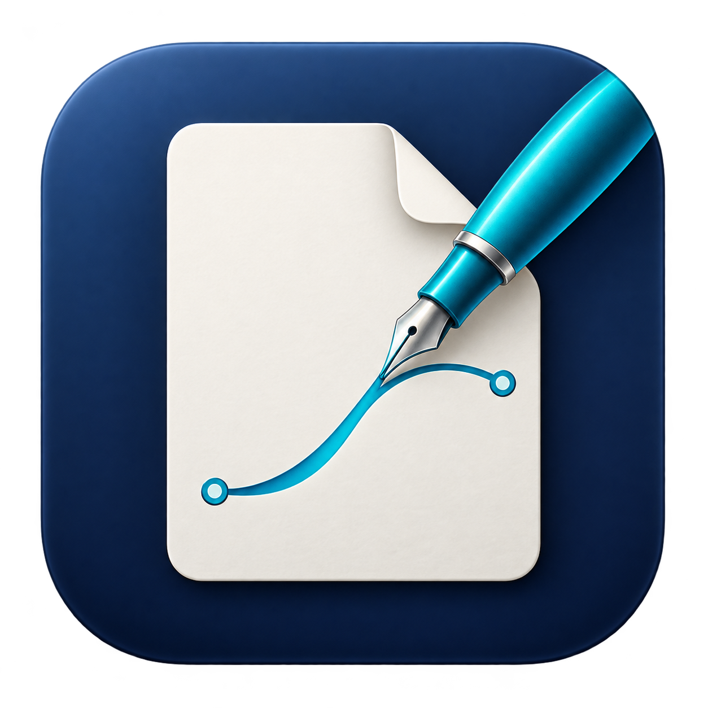

<h1 align="center">NotePDF</h1>

삼성 노트를, 선명한 PDF로.

<a href="https://github.com/kanghyunmin-bot/notepdf/releases">다운로드</a> · <a href="docs/BUILD.md">소스 빌드</a> · <a href="docs/VALIDATION.md">검증 범위</a> · <a href="https://github.com/kanghyunmin-bot/notepdf/issues">문제 신고</a>

Samsung Notes의 **`.sdocx` 파일을 벡터 PDF로 변환**하는 독립 앱입니다. **갤럭시 탭 / Android ARM64**와 **Apple Silicon Mac**에서 사용합니다. 변환 엔진을 내장하며 파일을 변환 서버로 보내지 않습니다.

## 다운로드

[최신 사전 릴리스 v1.0.0-rc.1](https://github.com/kanghyunmin-bot/notepdf/releases/tag/v1.0.0-rc.1)에서 받으세요.

| 기기 | 파일 | 요구 사항 |
| --- | --- | --- |
| 갤럭시 탭 / Android | `NotePDF-1.0.0-rc.1-android-arm64.apk` | Android 8.0 이상, ARM64 |
| Mac | `NotePDF-1.0.0-rc.1-macos-arm64.zip` | macOS 14 이상, Apple Silicon |
| 소스 | `NotePDF-1.0.0-rc.1-sources.zip` | 앱·변환 엔진 소스, 의존성 잠금, 라이선스 |

**사전 릴리스입니다.** Android 에뮬레이터 검증과 실제 갤럭시 탭 검증은 구분합니다. Mac 앱은 로컬 서명이며 Apple Developer ID 서명·공증을 받은 앱은 아닙니다. Intel Mac, Windows, iPadOS 및 32비트 Android는 이 릴리스 대상이 아닙니다.

## 갤럭시 탭에서 사용하기

1. APK를 다운로드하고 설치합니다. 기기 정책에 따라 APK 설치가 제한될 수 있습니다.
2. 삼성 노트에서 문서를 **Samsung Notes 파일(.sdocx)**로 저장합니다. PDF나 Word 형식이 아닙니다.
3. NotePDF에서 **노트 선택**을 누르거나, 삼성 노트의 **공유 → Samsung Notes 파일 → NotePDF**를 선택합니다. 여러 파일도 선택할 수 있습니다.
4. 변환 후 미리보기에서 페이지를 확인합니다. **PDF 저장**을 눌러 원하는 폴더에 내보냅니다.
5. **PDF 열기**를 누르면 설치된 PDF 뷰어에서 벡터 원본을 열 수 있습니다.

긴 변환은 알림과 함께 계속되며 앱 또는 알림에서 취소할 수 있습니다. 알림 표시 권한을 허용하면 상태 확인이 편리합니다. 결과는 앱 내부에도 보관됩니다. **앱을 삭제하기 전에 PDF 저장으로 내보내세요.** 실패하거나 취소한 노트는 다시 선택해 변환합니다.

## Mac에서 사용하기

ZIP을 풀고 `NotePDF.app`을 응용 프로그램 폴더로 옮겨 실행합니다. `.sdocx` 파일을 끌어놓거나 **파일 추가**를 누른 다음 **PDF로 변환**을 누르세요. 저장 위치는 기본적으로 원본 옆이며 다른 폴더를 선택할 수 있습니다. 같은 이름의 파일이 있으면 번호를 붙여 보존합니다.

## 어떤 부분이 선명해지나요?

- 필기와 도형을 이미지 대신 수학적 경로로 저장해 확대해도 선이 선명합니다.
- 노트의 페이지 구분, 배치, 색상을 가능한 한 유지합니다.
- 삽입된 PDF도 포함합니다. PDF 안에 이미 이미지였던 수식·사진은 원래 해상도를 유지합니다.
- 페이지 구분 없는 긴 노트는 원래 길이 / A4 세로 분할 / 삽입 PDF 기준 중 선택할 수 있습니다.

**원본과 완전히 같은 결과를 보장하지는 않습니다.** 타이핑한 본문, 웹 링크, 그림 도구, 일부 이미지 형식·펜 효과는 생략되거나 다르게 표시될 수 있습니다. 변환 후 원본과 비교하세요. `.sdoc`, `.docx`, 일반 PDF는 입력으로 지원하지 않습니다. Android는 입력 파일당 512MB 이하, 변환 시간은 파일당 10분으로 제한합니다.

## 개인정보

Android 앱에는 `INTERNET`, 전체 파일 접근, 연락처 등의 권한이 없습니다. 시스템 파일 선택기로 허용한 문서를 읽고 원본을 변경하지 않습니다. 변환용 임시 복사본은 작업 후 삭제됩니다. 완성된 PDF와 변환 내역은 앱 내부에 남습니다. 분석 SDK나 파일 업로드 기능은 없습니다. 선택한 파일 제공자가 클라우드 저장소이면 Android 파일 제공자 자체가 다운로드할 수 있습니다.

## 기반 프로젝트와 라이선스

- [squ1dd13/sdocx2pdf](https://github.com/squ1dd13/sdocx2pdf): 실제 SDOCX 파싱·필기 벡터화 엔진. v0.4.0을 고정해 사용하며 MIT 고지를 보존합니다.
- [kanghyunmin-bot/topdf](https://github.com/kanghyunmin-bot/topdf): 오프라인 엔진 내장, 시스템 파일 선택/저장, 서명된 APK 패키징 및 검증 범위를 구분하는 릴리스 구조를 참고했습니다.
- Android 파일 접근은 [Storage Access Framework](https://developer.android.com/guide/topics/providers/document-provider), 긴 변환은 [dataSync foreground service](https://developer.android.com/develop/background-work/services/fgs/service-types#data-sync)를 사용합니다.

앱 자체 코드는 [MIT](LICENSE). 변환 엔진 및 의존성은 각 원저작자의 라이선스를 따릅니다. [엔진 출처와 Android 수정](engine/UPSTREAM.md), [제3자 고지](legal/THIRD_PARTY.txt)를 참고하세요. 로고는 AI 이미지 생성으로 제작했고 [프롬프트](Assets/logo-prompt.txt)를 함께 제공합니다. Samsung과 관계없는 독립 프로젝트입니다.
